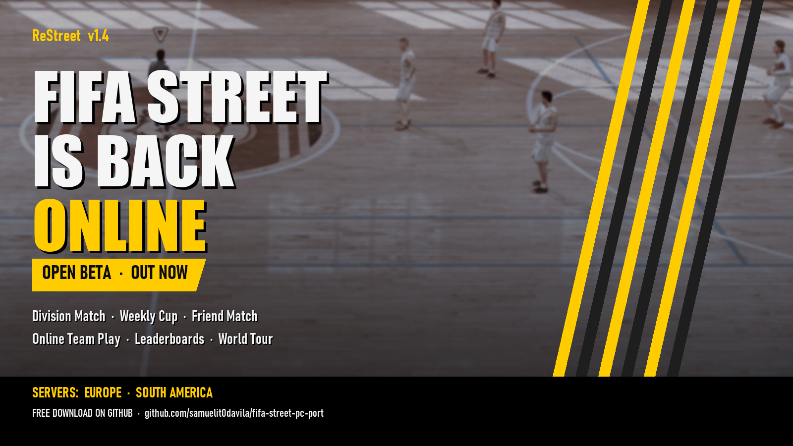

# ReStreet - FIFA Street 2012 Recompiled

**FIFA Street (2012) on Windows PC, built with ReXGlue. Bring your own game.**

### Ported by: SamuelitoDaVila

[Download](https://github.com/samuelit0davila/fifa-street-pc-port/releases/latest) · [Changelog](CHANGELOG.md) · [Report a bug](https://github.com/samuelit0davila/fifa-street-pc-port/issues) · [Build from source](docs/BUILDING.md)

## What is this

ReStreet is a Windows PC version of FIFA Street (2012) made by recompiling the Xbox 360 game with [ReXGlue](https://github.com/rexglue/rexglue-sdk). It comes with a graphical installer and a launcher with Direct3D 12 and Vulkan support, display and resolution settings, and performance profiles.

You need your own copy of the game: an Xbox 360 ISO of FIFA Street (2012). The ISO and the game files are not included.

**Online play** is a free open beta: a patch you install over v1.3. The latest is **v1.5.4 Online Beta**.

## What's new in v1.5.4 (Online Beta)

- **Matches tab in the launcher:** post a match with a title, mode and stadium, see every open match on your server and join the one you want; both press PLAY and the game goes to the match set-up by itself.
- **Smoother launcher:** no flash of the old interface at start, and no false "Server not reachable" after a single slow moment.
- On v1.5.1 or newer the launcher installs this update by itself. From older versions, download **ReStreet-1.5.4-Online-Beta.exe** from the [v1.5.4 release](https://github.com/samuelit0davila/fifa-street-pc-port/releases/tag/v1.5.4-online-beta).

## What's new in v1.5.3 (Online Beta)

- **Open games go to the match by themselves:** create or join a game in the launcher, both press PLAY, and the game skips the title screens and reaches the Friend Match set-up with your opponent.
- **New launcher everywhere:** without WebView2 (Linux with Wine/Proton, or Windows without the runtime) the same interface opens in its own window through your browser.
- Fixes: false "Chat is not available" message; red crosses in the old launcher window on Wine.
- On v1.5.1 or v1.5.2 the launcher installs this update by itself. From older versions, download **ReStreet-1.5.3-Online-Beta.exe** from the [v1.5.3 release](https://github.com/samuelit0davila/fifa-street-pc-port/releases/tag/v1.5.3-online-beta).

## What's new in v1.5.2 (Online Beta)

- **Open games in the launcher:** create a game (mode and stadium) or join one in one click from the Social page; when it is full, PLAY takes both players to the match.
- **See who is looking for a match:** the mode each player is searching for and how long they have waited.
- On v1.5.1 the launcher installs this update by itself (**Update now**). From older versions, download **ReStreet-1.5.2-Online-Beta.exe** from the [v1.5.2 release](https://github.com/samuelit0davila/fifa-street-pc-port/releases/tag/v1.5.2-online-beta).

## What's new in v1.5.1 (Online Beta)

- **Automatic updates:** the launcher finds new versions on GitHub, downloads and checks them (SHA-256) and installs them for you, keeping your name, server and saves. v1.5.1 is the last patch you install by hand.
- **Performance page in the launcher:** your FPS in matches, replays and menus for the last 30 sessions, the graphics card the game really used, crashes, and tips (for example when the game ran on integrated graphics).
- Performance reports now include the graphics card name.
- Installs over v1.3, v1.4 or v1.5. Download **ReStreet-1.5.1-Online-Beta.exe** from the [v1.5.1 release](https://github.com/samuelit0davila/fifa-street-pc-port/releases/tag/v1.5.1-online-beta).

## What's new in v1.5 (Online Beta)

- **New launcher:** a glass design with live server ping and player counts, and a server switch (Europe / South America).
- **Social page in the launcher:** who is online and what they are doing, friends and friend requests, a general chat per server and private chats with friends, block and report.
- **Laptops with two graphics cards:** the game now picks the dedicated card automatically on Direct3D 12 and Vulkan.
- **Performance reports:** after each session the launcher shows your FPS in matches, replays and menus, and, if you agree, sends an anonymous report (graphics card, processor, memory, settings, FPS; no name, no account) so we can find where the game is slow on real PCs. Turn it off in Advanced.
- Installs over **v1.3** or over the **v1.4 Online Beta Test**, keeping your saves, settings and online name. Download **ReStreet-1.5-Online-Beta.exe** from the [v1.5 release](https://github.com/samuelit0davila/fifa-street-pc-port/releases/tag/v1.5-online-beta).

## What's new in v1.4 (Online Beta Test)

FIFA Street 2012 is back online. EA shut the servers down years ago; now you can play the original online modes again on community servers, with real people.

- **Street Season, Division Match:** get matched with a real opponent, play 10-game seasons, earn promotion or fight relegation.
- **Street Season, Cup Match:** a new cup every week, a full tournament bracket and a trophy for the winner.
- **Friend Match:** invite a friend and play.
- **Online Team Play:** pick your side and play as a team.
- **Friends (Xbox Guide, Guide button or F6):** friends list, add friends, gamer cards and invites.
- **EA SPORTS Hub (Back button on the main menu):** News Feed with your and your friends' results, leaderboards (Top 100, My 100, Friends and Country) and EAS FC levels.
- **World Tour:** Play Online (Gold).
- **Discord Rich Presence:** your Discord profile shows *Playing ReStreet PC* and what you are doing.
- **Two servers:** Europe (Europe, Africa, Middle East) and South America. Each server has its own players, seasons, friends and leaderboards; pick the same server as your friends.
- **New launcher design.**

### Install the online beta (v1.5.4)

1. Install **ReStreet v1.3** first ([download v1.3](https://github.com/samuelit0davila/fifa-street-pc-port/releases/tag/v1.3)).
2. Close the launcher and the game.
3. Run **ReStreet-1.5.4-Online-Beta.exe** from the [v1.5.4 release](https://github.com/samuelit0davila/fifa-street-pc-port/releases/tag/v1.5.4-online-beta), pick your ReStreet folder, choose your online name and your server.
4. Open the launcher (it shows **V1.5.4 · ONLINE BETA**) and press **PLAY**.

Your saves and settings are kept. Your online name is protected by a personal key stored in `online.json`: keep a copy of that file if you reinstall. To go back to offline, run the patch again and choose **Remove the online patch**.

**Known issues:** no Rematch at the end of a match yet; Street Network video uploads are off for now; in Online Team Play the second player's game can rarely stay on the loading screen (restart the game); do not leave your player idle in a match, the game removes inactive players.

## What's new in v1.3

- **True VSync on Direct3D 12 and Vulkan:** no tearing and a new frame on every refresh, at any refresh rate you pick in the launcher (60, 120, 144, 165 Hz and beyond).
- **Smooth motion:** each refresh shows the game's newest frame, with no half-rate drops or stutter when the game window has focus. Works with **Adaptive Sync / FreeSync** on.
- **Honest FPS counter:** with VSync on, the in-game counter shows the frames that reach the screen, the same number as AMD, NVIDIA and other overlays.
- **VSync off = no frame limit.**
- **Clean stadium floors** on every graphics card, and a menu crash fixed.
- Installs over v1.2. Saves and settings are kept. See the full [changelog](CHANGELOG.md).

## What's new in v1.2

- **Cutscenes and goal replays at your refresh rate**, no longer capped at 40 FPS.
- **Goals and match setup no longer drop to 30-40 FPS**, and menus run at 60 FPS.
- **Vulkan: goal replays are sharp** (they were blurred).
- **Direct3D 12 with VSync on no longer falls to 1 FPS** on some laptops.
- **Updating removes the online patch**, and works over v1.1 with or without it. Saves and settings are kept. See the full [changelog](CHANGELOG.md).

## What's new in v1.1

- **ReStreet main menu logo**, applied from the new `Mods` folder without changing your game files.
- **Improved "Some" graphics readback**, now the default: less graphical garbage on floors and reflections, with the same speed.
- **VSync works smoothly.** It keeps the game locked to your refresh rate with no tearing.
- **Direct play:** start the game without the launcher window using `FifaStreetLauncher.exe --play`, or create a desktop shortcut with the new **Shortcut** button.
- **Launcher and setup fit any screen**, at any resolution and Windows scale.
- Your saves and settings are kept when you update. See the full [changelog](CHANGELOG.md).

## What's new in v1.0

- **Performance profiles** in the launcher: Balanced (default), Quality for strong PCs, and Performance for weaker PCs.
- **Shader cache included**, so the first matches have fewer slow moments.
- **FPS counter:** press **Home** to show or hide it.
- **Exit shortcut:** hold **START** and press **B** (Xbox layout) or **START** and **Circle** (PlayStation layout) to open the exit prompt. A confirms, B cancels.
- **New launcher and installer design.** Both follow the Windows display scale and shrink to fit small screens.
- Same game files as v0.4.1, so your saves and settings keep working. See the full [changelog](CHANGELOG.md).

## Download and install

1. Download **FifaStreetSetup.exe** from the [latest release](https://github.com/samuelit0davila/fifa-street-pc-port/releases/latest) and check its SHA-256 against the value on the release page.
2. Run it, choose your FIFA Street ISO and an empty folder, then press **INSTALL ReStreet**.
3. When it finishes, press **OPEN LAUNCHER**, pick your settings and press **PLAY**.

To update from an earlier version, select the folder that contains `Game` and `GameData`. No ISO is needed, and your saves and settings are kept. Only game versions that match the three verified original module hashes are accepted.

No compiler, Visual Studio or Internet connection is needed.

## System requirements

These are estimates from my own testing, not guarantees. If you try it on an older PC, tell me your specs and FPS.

| | |
|---|---|
| System | Windows 10 or 11, 64-bit |
| CPU | x86-64 with SSSE3; a quad-core is safest |
| GPU | Direct3D 12 or Vulkan with up-to-date drivers (about GTX 900 / RX 400 or newer) |
| RAM | 8 GB |
| Disk | 12 GB free to install, 2 GB to update |
| Game | Your own FIFA Street (2012) Xbox 360 ISO |

On a weaker PC, choose the **Performance** profile in the launcher.

## Graphics backends

The launcher packages two validated ReXGlue graphics backends: **Direct3D 12** (the default, with GPU selection) and **Vulkan** (automatic device selection). It switches the matching runtime files by itself when you change the graphics API.

Full readback is the validated mode for both. The Compatibility panel offers Some, Fast and None for more FPS, but those modes are not validated and can cause graphical corruption.

## Resolution

Output resolution and internal rendering resolution are separate settings.

- **Output resolution:** the window or screen size, for example 1280x720 up to 3840x2160.
- **Internal resolution:** a whole-number scale of the game's 1280x720 base: 1x is 1280x720, 2x is 2560x1440, 3x is 3840x2160 and 4x is 5120x2880.

High settings are there for testing and do not promise 60 FPS.

## Status

This is the first stable release, but it is still a community port: performance depends on your hardware, drivers and settings. World Tour, Practice, Direct3D 12 and Vulkan were tested on earlier releases; this release changes the launcher, installer, overlays and the performance options.

See [known issues and validation](docs/STATUS.md). If you find a problem, [open an issue](https://github.com/samuelit0davila/fifa-street-pc-port/issues) with your hardware, Windows and driver versions, the graphics API and settings, and the logs from **Open logs** in the launcher. Please do not upload ISOs or game files.

## Credits and licence

I developed this project with assistance from **ChatGPT, OpenAI Codex and Anthropic's Claude (Claude Code)**, and directed and tested the work myself.

Thanks to **Emran_Ahm3d** for investigating and suggesting the Windows patch line-ending fix, module-registration path handling, flexible game-data paths, the FootballCompEng function-boundary override and resource-compiler compatibility, and for the **Discord Rich Presence** integration in the launcher (the "Playing ReStreet PC" card, its `presence.json` configuration and setup guide), included since v1.4.

Country leaderboard data: IP to country by [DB-IP.com](https://db-ip.com) (CC BY 4.0).

Thanks to [ReXGlue](https://github.com/rexglue/rexglue-sdk), [Xenia](https://github.com/xenia-project/xenia), [extract-xiso](https://github.com/XboxDev/extract-xiso), LLVM, CMake, Ninja, .NET and MonoGame. See the [third-party notices](licenses/README.md).

My original installer, launcher and scripts use the [MIT License](LICENSE). Third-party components keep their own licences. The installer includes generated game binaries; the MIT licence does not establish the right to redistribute them, and no legal clearance is claimed. FIFA Street, its game content, artwork and trademarks belong to their respective owners.

This is an unofficial community project, with no affiliation to EA, Microsoft or Xbox.
