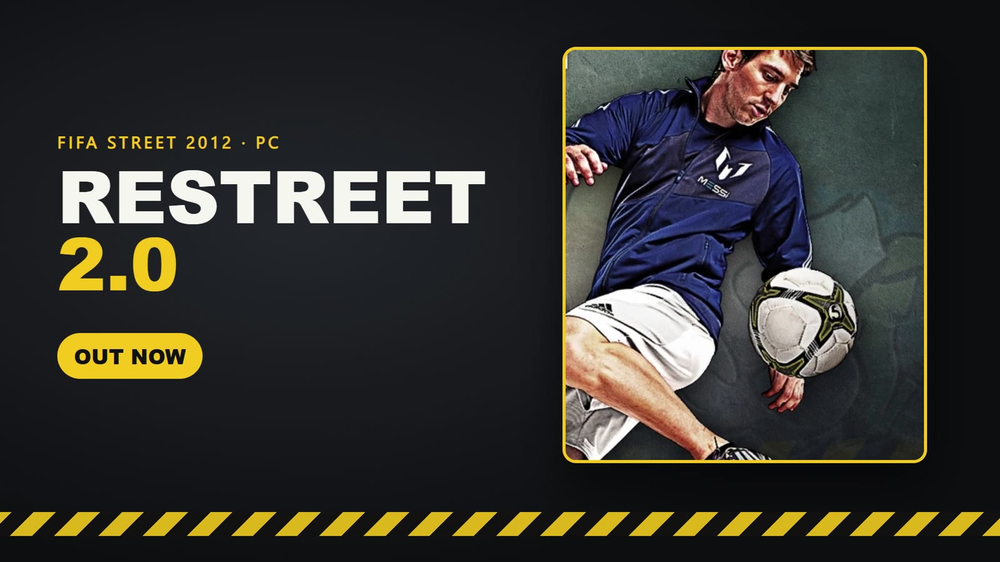

# ReStreet — FIFA Street (2012) on PC

**FIFA Street (2012) recompiled for Windows, with online play. Bring your own game.**

### Ported by: SamuelitoDaVila

[**Download**](https://github.com/samuelit0davila/fifa-street-pc-port/releases/latest) · [Changelog](CHANGELOG.md) · [Known issues](docs/STATUS.md) · [Report a bug](https://github.com/samuelit0davila/fifa-street-pc-port/issues) · [Build from source](docs/BUILDING.md)

## What is this

ReStreet is a Windows PC version of FIFA Street (2012), made by recompiling the Xbox 360 game. It comes with a one-file installer, a launcher, and free online play on community servers (Europe and South America).

You need your own copy of the game: an **Xbox 360 ISO of FIFA Street (2012)**. The ISO and the game files are not included.

**Current version: 2.0.3 Online Beta.**

## What's new in 2.0

- **New graphics engine**, based on AnDr3zF's "Deck" port: sharper image and much higher frame rates (about 400 FPS in a match on the test PC). Direct3D 12 and Vulkan.
- **Graphics options:** FSR 1, internal resolution up to 4x, aspect ratio, anisotropic filtering, ambient occlusion (SSAO / HBAO / GTAO), MSAA, FXAA and an FPS limit.
- **Launcher social page:** who is online, friends and requests, chat, and **game rooms** that bring both players to the same lobby.
- **In-game friends Guide:** press **F6** (or the Xbox button on a controller) to see your friends and invite them. Accept an invite with A / Space, decline with B / Shift.
- **Brazilian Portuguese** translation by Eze_.
- **Automatic updates:** the launcher finds new versions, checks them and installs them, keeping your name, server, settings and World Tour progress.

Full history: [CHANGELOG.md](CHANGELOG.md).

## Download and install

**New install**

1. Download **ReStreet-2.0.3-Setup.exe** from the [latest release](https://github.com/samuelit0davila/fifa-street-pc-port/releases/latest). Optionally check it against the `.sha256` file next to it.
2. Run it, choose your FIFA Street ISO, a folder, your online name and your server (Europe or South America).
3. Open the launcher from the desktop shortcut and press **PLAY**.

**Already have ReStreet?**

- On **1.5.1 or newer**: open the launcher and press **Update**. That's it.
- On an older version: run the setup and pick your ReStreet folder. No ISO is needed; saves, settings and your online name are kept.

## System requirements

Estimates from testing, not guarantees.

| | |
|---|---|
| System | Windows 10 or 11, 64-bit |
| CPU | x86-64; a quad-core is safest |
| GPU | Direct3D 12 or Vulkan with up-to-date drivers |
| RAM | 8 GB |
| Disk | about 12 GB free for a new install |
| Game | Your own FIFA Street (2012) Xbox 360 ISO |

On a weaker PC, choose the **Performance** profile in the launcher. Linux with Wine / Proton has not been tested on 2.0 yet.

## Online play

- Free open beta on two servers: **Europe** and **South America**. Players, friends and leaderboards are per server.
- Online modes, friend invites, launcher rooms and the News Feed work. Chat is in the launcher.
- Your World Tour team is shown to other players on your server.

## Known limits (2.0)

- No mouse for skill moves yet (the launcher hides that option on 2.0).
- Vulkan can have small stutters; use Direct3D 12 if you see them.
- The game renders internally at 1280x720 and is scaled to your screen.
- START + B also shows the game's own "leave this session?" question behind the launcher's; close it with A.
- A launcher room does not pull a player out of another lobby; leave that lobby first.
- Two copies of the game on the same PC can lose the connection after an invite (different PCs are fine).
- Player portraits in World Tour (My Squad) look scrambled; being worked on.

More details and what was tested: [docs/STATUS.md](docs/STATUS.md).

## Reporting a problem

[Open an issue](https://github.com/samuelit0davila/fifa-street-pc-port/issues) or ask on Discord with:

- your ReStreet version, Windows version, CPU, GPU and RAM;
- the graphics API (Direct3D 12 or Vulkan) and your launcher settings;
- what happened and how to repeat it;
- the logs: **Open logs** in the launcher (`Binaries\Logs\fifastreet.log` and `launcher_settings.txt`).

Please do not upload ISOs or game files.

## Credits and licence

- **SamuelitoDaVila** — port, online services, launcher, installer, 2.0 integration and testing.
- **AnDr3zF** — the "Deck" port that the 2.0 graphics engine is built on.
- **Eze_** — Brazilian Portuguese translation.
- **Emran_Ahm3d** — Windows build fixes, game-data discovery, FootballCompEng function boundaries, and the Discord Rich Presence integration.
- Developed with assistance from ChatGPT, OpenAI Codex and Anthropic's Claude (Claude Code), directed and tested by SamuelitoDaVila.

Thanks to [ReXGlue](https://github.com/rexglue/rexglue-sdk), [Xenia](https://github.com/xenia-project/xenia), [extract-xiso](https://github.com/XboxDev/extract-xiso), LLVM, CMake, Ninja, .NET and MonoGame. Country data: IP to country by [DB-IP.com](https://db-ip.com) (CC BY 4.0). See [CREDITS.md](CREDITS.md) and the [third-party notices](licenses/README.md).

My original installer, launcher and scripts use the [MIT License](LICENSE). Third-party components keep their own licences. The installer includes generated game binaries; the MIT licence does not establish the right to redistribute them, and no legal clearance is claimed. FIFA Street, its game content, artwork and trademarks belong to their respective owners.

This is an unofficial community project, with no affiliation to EA, Microsoft or Xbox.
